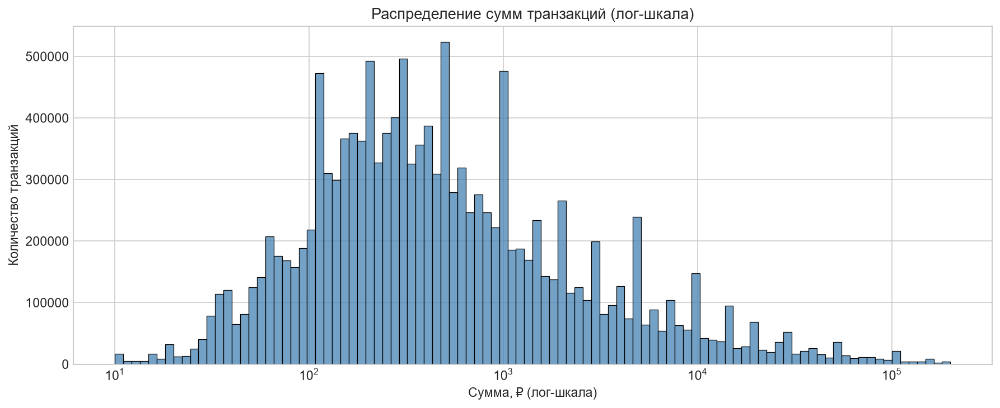
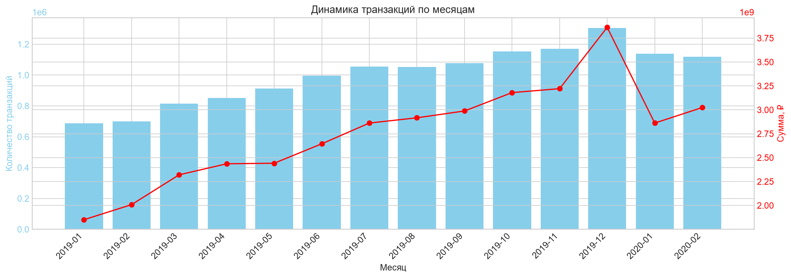
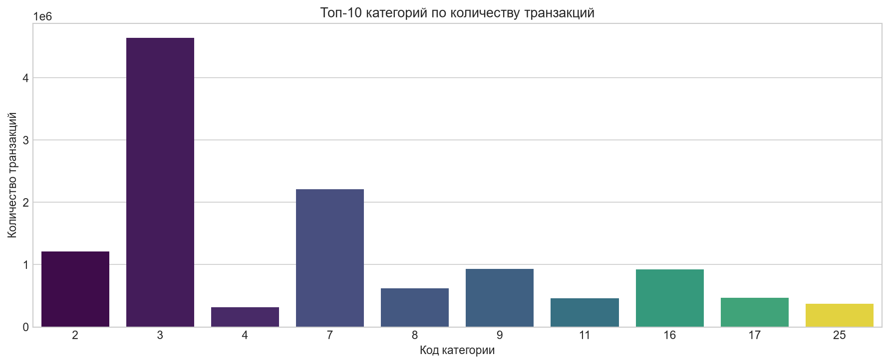
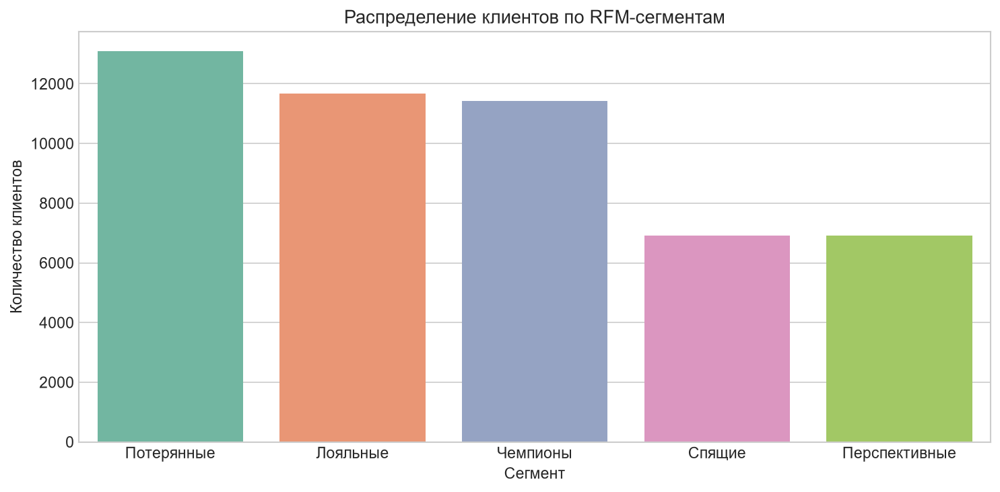
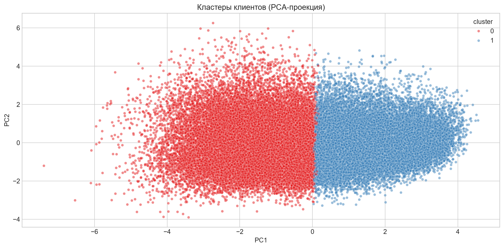
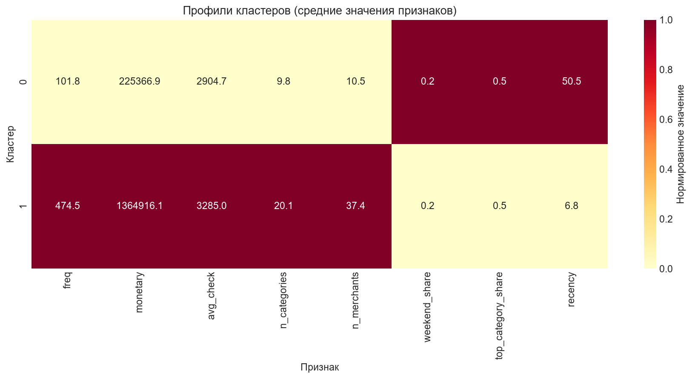
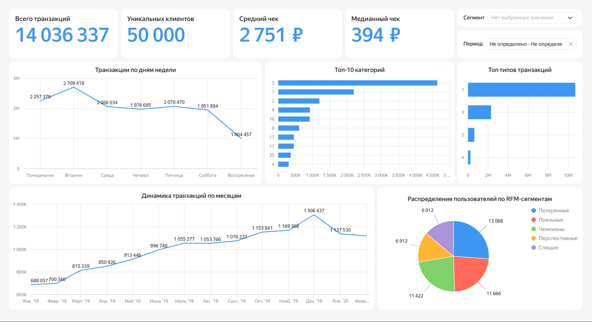
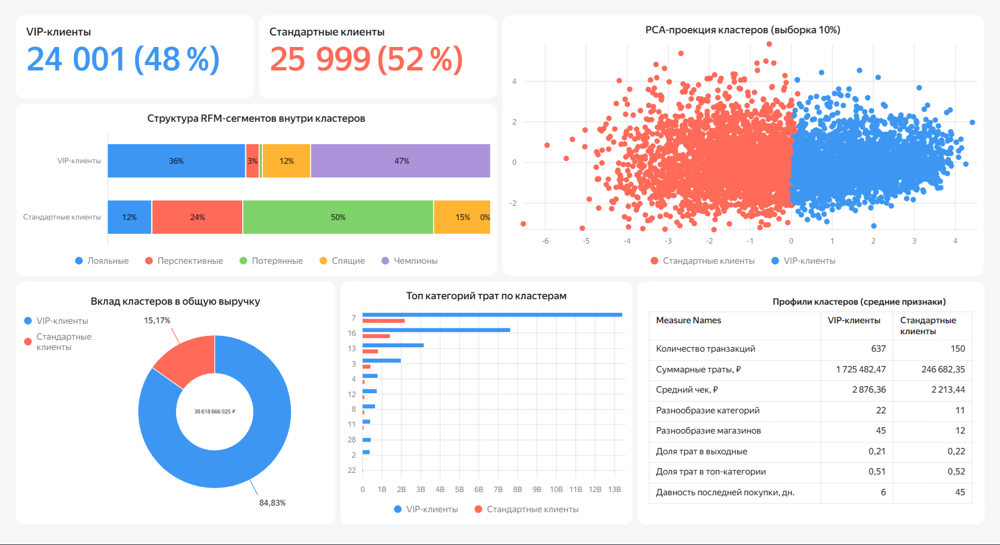

# Анализ транзакций клиентов Т-Банка


## 📋 О проекте

End-to-end анализ транзакционного поведения клиентов Т-Банка на основе открытого датасета TTRS. Проект охватывает загрузку и очистку данных, разведочный анализ (EDA), RFM-сегментацию, кластеризацию клиентов (KMeans) и интерактивный дашборд в Yandex DataLens.

**Объём данных:** 14 287 287 транзакций изначально → 14 036 337 после очистки (79%).
**Уникальных пользователей:** 50 000.
**Период данных:** 2019-01-01 – 2020-02-29 (14 месяцев).
**Источник:** [TTRS (Tinkoff Transactions Recommender System benchmark)](https://huggingface.co/datasets/pytorch-lifestream/ttrs) (CC BY-NC-SA 4.0).

## 🎯 Бизнес-проблема

Банк стремится увеличить прибыль за счёт персонализации маркетинга и удержания клиентов. Без понимания глубинных паттернов потребления сложно определить: 
- какие сегменты клиентов приносят основную выручку;
- как отличается структура потребления у разных групп;
- какие категории являются драйверами трат.

**Цель исследования:** провести ETL-очистку транзакций, сегментировать клиентов с помощью RFM-анализа и KMeans, а также создать интерактивный дашборд для принятия решений на основе данных.

## 📊 Ключевые результаты

### Портрет рынка (EDA)

- **Объём:** 14,0 млн транзакций, 50 000 клиентов.
- **Средний чек:** 2 751 ₽, **медианный** — 394 ₽. Распределение сильно скошено вправо: несколько крупных платежей тянут среднее вверх, поэтому для анализа используется медиана.
- **Сезонность:** пик активности приходится на **декабрь 2019** (предновогодние покупки), резкий спад — в **январе 2020**. 
- **День недели:** наибольшее количество транзакций совершается во **вторник**, наименьшее — в воскресенье. 
- **Топ категорий:** лидируют категории 3, 7 и 2.





### RFM-сегментация

Классический RFM-анализ разделил клиентов на 5 групп (по абсолютным числам):
- **Потерянные** (13 088 чел.) — низкая частота, давно не покупали.
- **Лояльные** (11 666 чел.).
- **Чемпионы** (11 422 чел.) — самые частые и ценные клиенты.
- **Спящие** (6 912 чел.).
- **Перспективные** (6 912 чел.).



### Кластеризация клиентов (KMeans)

Метод KMeans (с предварительным логарифмированием и стандартизацией признаков) разделил клиентов на 2 чётких кластера. Оптимальное число `k` определено по Silhouette Score.

- **Кластер 1: «VIP-клиенты» (24 001 чел. / 48%)** 
  - В среднем совершают **637 транзакций**, суммарные траты — **1,72 млн ₽**.
  - Покупают в **22 категориях** и у 45 продавцов.
  - Давность последней покупки — всего **6 дней**.
- **Кластер 0: «Стандартные клиенты» (25 999 чел. / 52%)** 
  - В среднем совершают **150 транзакций**, суммарные траты — **246 тыс. ₽**.
  - Покупают в **11 категориях** и у 12 продавцов.
  - Давность последней покупки — **45 дней**.




## 🖥️ Дашборд Yandex DataLens

**[🔗 Открыть интерактивный дашборд (публичная ссылка)](https://datalens.yandex/x8h7slu8dcxog?_share_link=public)**

Дашборд состоит из двух страниц: «Обзор рынка» (Executive Summary) и «Кластеры клиентов» (Deep Dive). Включает KPI-карточки, срезы по периодам и сегментам, а также кросс-фильтрацию.




## 💡 Рекомендации для бизнеса

1. **Фокус на VIP-клиентах (Кластер 1):** Они составляют всего 48% базы, но приносят **84,8% всей выручки** банка. Это самая ценная группа, требующая индивидуальных предложений и повышенного кэшбэка в категориях-драйверах (категории 7, 16, 13).
2. **Реактивация «Потерянных» (Кластер 0):** Внутри стандартного кластера 50% составляют «Потерянные» по RFM. Банку необходимо запустить триггерные маркетинговые кампании для возврата этой аудитории (например, повышенный кэшбэк на 1-2 месяца).
3. **Дифференциация предложений:** «VIP» тратят много и часто (в 4,5 раза чаще стандартных), их средний чек — 2 876 ₽. «Стандартные» тратят более сфокусированно (52% в топ-категории), их средний чек — 2 213 ₽.

## 🧰 Стек технологий

| Слой | Технологии |
|---|---|
| **ETL** | Python (Pandas, NumPy) |
| **Хранение** | PostgreSQL, SQLAlchemy |
| **Анализ** | SQL (оконные функции, CTE), RFM-анализ |
| **ML** | Scikit-learn (KMeans, PCA, StandardScaler, Silhouette) |
| **BI** | Yandex DataLens (визуализация, дашборды) |
| **Jupyter** | Notebooks для очистки, EDA и кластеризации |

## 🛠 Методология

1. **Загрузка и очистка** — `notebooks/01_data_loading_and_cleaning.ipynb`. Удалены дубликаты, нулевые суммы, отфильтрованы выбросы (99.9-й перцентиль).
2. **EDA и RFM** — `notebooks/02_eda_and_rfm.ipynb`. Анализ сезонности, топ-категорий, распределения сумм. Расчёт Recency, Frequency, Monetary и сегментация на 5 групп.
3. **Кластеризация** — `notebooks/03_customer_clustering.ipynb`. Создание признаков (частота, сумма, средний чек, разнообразие), логарифмирование, стандартизация, KMeans, визуализация через PCA.
4. **Загрузка в БД** — `scripts/load_to_db.py`. Создание таблиц и загрузка данных.
5. **Визуализация** — дашборд в Yandex DataLens.

## 📁 Структура проекта

```
bank-transactions-analysis/
├── data/
│   ├── raw/                  # Сырые данные (не коммитятся)
│   └── processed/            # Очищенные данные (не коммитятся)
├── images/
│   ├── eda/                  # Визуализации из ноутбуков
│   ├── clustering/           # Графики кластеризации
│   └── datalens/             # Скриншоты дашборда
├── notebooks/
│   ├── 01_data_loading_and_cleaning.ipynb
│   ├── 02_eda_and_rfm.ipynb
│   └── 03_customer_clustering.ipynb
├── scripts/
│   └── load_to_db.py
├── .env.example
├── .gitignore
├── README.md
└── requirements.txt
```

## 🚀 Как запустить

1. Клонируйте репозиторий.
2. Установите зависимости: `pip install -r requirements.txt`
3. Скопируйте `.env.example` → `.env` и впишите параметры БД.
4. Создайте БД `bank_transactions` в PostgreSQL.
5. Скачайте датасет TTRS и положите его в `data/raw/ttrs.csv`.
6. Выполните `notebooks/01...`, `02...`, `03...` последовательно.
7. Запустите `python scripts/load_to_db.py` — загрузит данные в PostgreSQL.
8. Откройте дашборд в Yandex DataLens.

## ⚠️ Ограничения

1. **Период данных:** срез 2019–2020 гг., без более свежих данных.
2. **Отсутствие времени:** в датасете нет точного времени транзакций (только даты), поэтому нельзя проанализировать часовые пики активности.
3. **Средний чек:** сильно искажён выбросами (поэтому опираемся на медиану).

## 🗺 Что дальше

- Построить модель машинного обучения (Gradient Boosting) для предсказания вероятности оттока (Churn Prediction).
- Внедрить A/B-тестирование для проверки гипотез по кэшбэку для VIP-клиентов.
- Обновить данные до 2024–2025 гг. для анализа актуальных трендов.

## 👤 Автор

Сухих Елизавета, Junior Data Analyst
- GitHub: [@veta-suhih](https://github.com/veta-suhih)
- LinkedIn: [@vetasuhih](https://www.linkedin.com/in/vetasuhih)
- Telegram: [@veta_suhih](https://t.me/veta_suhih)
- Email: [veta.suhih@gmail.com](mailto:veta.suhih@gmail.com)

## 📄 Лицензия

MIT — используйте код свободно в учебных и коммерческих целях.